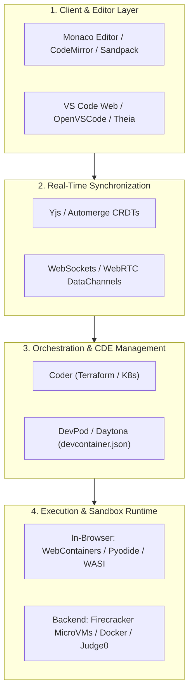

  

# 🚀 Awesome Collaborative Coding & Cloud IDEs

  
  
  
  
  

---

## 📖 Overview & Ecosystem Guide

A comprehensive, SEO-optimized, and curated directory of **Collaborative Coding Platforms**, **Cloud IDEs (Integrated Development Environments)**, **Cloud Development Environments (CDEs)**, and **Multiplayer Web Sandboxes**. 

Whether you are looking for enterprise-grade remote developer environments that standardize toolchains across engineering organizations, lightweight browser-based WebContainer sandboxes for instantaneous frontend prototyping, or self-hosted open-source remote VS Code instances accessible from any device or tablet, this guide catalogs both SaaS and open-source solutions.

---

## 📑 Table of Contents

- [📊 Sector Overview & Market Dynamics](#-sector-overview--market-dynamics)
- [☁️ SaaS & Hosted Cloud IDE Platforms](#️-saas--hosted-cloud-ide-platforms)
- [💻 Open-Source GitHub Projects & Self-Hosted CDEs](#-open-source-github-projects--self-hosted-cdes)
- [🛠️ Architecture & Building Blocks](#️-architecture--building-blocks)
- [🤝 How to Contribute](#-how-to-contribute)
- [☕ Support & Sponsorship](#-support--sponsorship)
- [📈 Star History](#-star-history)
- [⚖️ Disclaimer](#️-disclaimer)

---

## 📊 Sector Overview & Market Dynamics

The global **Cloud Development Environment (CDE) and Cloud IDE market** is estimated at **$5.5 Billion to $7.5 Billion** (2024–2025) and is projected to surpass **$16 Billion to $25 Billion by 2030–2032**, compounding at an annual growth rate (CAGR) of **14% to 17%**. 

The market is **moderately fragmented yet converging toward hybrid standards**: hyperscale cloud ecosystems (Microsoft GitHub Codespaces, Google Firebase Studio, AWS) dominate enterprise infrastructure, while specialized hyper-growth innovators (Replit, StackBlitz/Bolt.new) capture rapid prototyping and autonomous agent workflows. Simultaneously, an open-standard layer centered on Dev Containers (`devcontainer.json`), WebContainers, and Docker/Kubernetes orchestrators ensures developers maintain portability between self-hosted runtimes and managed commercial clouds.

---

## ☁️ SaaS & Hosted Cloud IDE Platforms

The following SaaS and managed hosted platforms provide instant, browser-accessible development environments, remote compute, and multiplayer pair programming capabilities. The table is ranked in descending order by company valuation/market scale.

| Platform | Valuation / Revenue Scale | Starting Tier Price | Free Tier / Trial Limits | Key Features & Core Focus |
| :--- | :--- | :--- | :--- | :--- |
| **[AWS Cloud9](https://aws.amazon.com/cloud9/)** | **~$2.1 Trillion** *(Amazon Market Cap; AWS ~$105B+ ARR)* | **$0.00 / mo** *(IDE free; pay only for underlying EC2/EBS infrastructure, starting at ~$0.0116/hr for `t3.micro`)* | **AWS Free Tier (12 Months):** 750 hours/month of `t2.micro`/`t3.micro` EC2 compute + 30 GB EBS storage (Cloud9 has no separate software fee). | Browser-based IDE running directly inside VPCs; pre-authenticated AWS CLI, direct Lambda debugging, auto-hibernation, and collaborative pair coding. |
| **[Firebase Studio](https://firebase.google.com)** *(formerly Project IDX)* | **~$2.1 Trillion** *(Alphabet / Google Market Cap)* | **$0.00 / mo** *(Free public preview; optional deployments link to Google Cloud Blaze pay-as-you-go)* | **Free Plan Quota:** Up to 3 active cloud workspaces per account (up to 10 workspaces with free Google Developer Program); max 2 concurrent Flutter/React Native workspaces; bundled Gemini AI assistant quota. | Google's full-stack agentic web & mobile workspace with Nix-configured reproducibility, built-in Android/iOS simulators, and deep Gemini code assistance. |
| **[GitHub Codespaces](https://github.com/features/codespaces)** | **~$100+ Billion** *(Microsoft GitHub division; Microsoft ~$3.1T Cap)* | **$0.18 / core-hour** + $0.07 / GB-month storage *(Usage-based billing past free limits)* | **GitHub Free Personal Plan:** 120 core hours per month (60 clock hours on standard 2-core machines) + 15 GB-month storage. | Native GitHub-integrated cloud environments spinning up via `devcontainer.json`, instant port forwarding, prebuilds, and full VS Code web/desktop sync. |
| **[Replit](https://replit.com)** | **$9.0 Billion** *(Valuation March 2026; ~$500M ARR)* | **$20.00 / user/mo** *(billed annually as Replit Core, or $25/mo monthly)* | **Starter Plan (Free Forever):** 0.5 vCPU, 512 MB RAM, 1 public published deployment, limited daily Replit AI chat credits, and single-builder workspace. | Browser-native multiplayer IDE with built-in PostgreSQL/Key-Value storage, one-click deployments, and autonomous Replit AI Agent workflows. |
| **[StackBlitz](https://stackblitz.com)** | **$700 Million** *(Valuation 2025; ~$40M+ ARR)* | **$18.00 / user/mo** *(billed annually as StackBlitz Pro, or $25/mo monthly)* | **Personal Free Plan (Forever Free):** Unlimited public projects and GitHub repos, full client-side WebContainers (Node.js & npm runtime in browser tab), 1 MB file upload limit; private repos require Pro. | Instant zero-latency full-stack browser runtime powered by WebContainers and home of Bolt.new AI app generation. |
| **[Gitpod (Ona)](https://gitpod.io)** | **~$120 Million** *(Estimated valuation; ~$41M VC funding raised)* | **$9.00 / user/mo** *(Pay-as-you-go / Flex team tiers starting at $9/seat)* | **Free Tier Allowance:** 50 hours of workspace compute per month (or 500 usage credits), public Git repositories, and up to 4 concurrent workspaces with 30-min idle timeout. | Automated ephemeral Cloud Development Environments (CDEs) spinning up pre-compiled workspaces directly from Git pull requests and branch URLs. |
| **[CodeSandbox](https://codesandbox.io)** | **~$50–$75 Million** *(Acquired by Together AI 2024; $15.2M funding)* | **$9.00 / user/mo** *(billed annually as Pro, or $12/mo monthly)* | **Free Workspace Plan (Forever Free):** Up to 5 team members, up to 40 hours of monthly microVM runtime credits, and microVM specs up to 4 vCPUs and 8 GB RAM. | Rapid microVM sandboxes running on Firecracker, instant snapshot restores (1–3s), live multiplayer editing, and React Sandpack embeddable components. |
| **[Glitch](https://glitch.com)** | **~$20 Million** *(Acquired by Fastly; legacy project hosting)* | **$8.00 / user/mo** *(Historical Glitch Pro starting tier)* | **Free Starter Account:** Instant browser code editing and remixable public Node.js/HTML apps; free apps sleep after 5 minutes of inactivity (cold start delay). | Friendly web development community and remixable code playground; ideal for static pages, expressive node demos, and interactive coding tutorials. |
| **[Codeanywhere](https://codeanywhere.com)** | **Legacy / Closed** *(Historical pioneer operational 2013–2026)* | **$9.60 / mo** *(Historical Basic plan prior to sunset)* | **14-Day Free Trial:** Historically provided 14 days of evaluation across 1 concurrent container before discontinuing operations in July 2026. | Pioneer container-based browser IDE supporting SSH, SFTP, and web-based VS Code/Theia containers. |

---

## 💻 Open-Source GitHub Projects & Self-Hosted CDEs

Every open-source repository below is actively maintained, enables collaborative or cloud-based coding, and displays live star metrics. The list is sorted in descending order by **GitHub Star Count**.

- **[Zed](https://github.com/zed-industries/zed)**   
  High-performance, GPU-accelerated code editor written in Rust with built-in real-time CRDT multiplayer editing, channels, integrated voice communication, and remote server connectivity.

- **[Code-Server](https://github.com/coder/code-server)**   
  Runs full VS Code on any remote Linux machine, cloud VPS, or Docker container and renders it directly through any modern web browser with full terminal and extension support.

- **[pingdotgg/t3code](https://github.com/pingdotgg/t3code)**   
  Modern open-source AI-native and collaborative development environment designed by Theo Browne (t3.gg) for controlling coding agents (Claude Code, Codex) from any browser or remote device.

- **[Daytona](https://github.com/daytonaio/daytona)**   
  Open-source Development Environment Manager (DEM) and elastic sandbox infrastructure for launching standardized developer workspaces and AI agent sandboxes with a single CLI command.

- **[Gitea](https://github.com/go-gitea/gitea)**   
  Painless, lightweight self-hosted all-in-one Git service and DevOps platform built in Go; pairs seamlessly with Code-Server and DevPod to create entirely private self-hosted cloud dev platforms.

- **[Monaco Editor](https://github.com/microsoft/monaco-editor)**   
  The browser-based code editor that powers VS Code; features IntelliSense, rich code formatting, syntax highlighting, diff viewers, and TypeScript/JavaScript language servers.

- **[Lapce](https://github.com/lapce/lapce)**   
  Lightning-fast open-source code editor written in Rust with GPU acceleration (Druid UI), native modal editing, remote development over SSH, and built-in LSP intelligence.

- **[Marimo](https://github.com/marimo-team/marimo)**   
  Next-generation reactive Python notebook that runs reproducible experiments, interactive web apps, and collaborative computational workflows stored as clean, version-controllable pure Python scripts.

- **[Yjs](https://github.com/yjs/yjs)**   
  High-performance Conflict-free Replicated Data Type (CRDT) implementation for building real-time multiplayer collaborative applications, live shared code editors, and P2P synchronization.

- **[Eclipse Theia](https://github.com/eclipse-theia/theia)**   
  Extensible open-source platform for creating customized cloud & desktop IDEs and developer tools in TypeScript, supporting VS Code extensions and multi-tenant architectures.

- **[Coder](https://github.com/coder/coder)**   
  Enterprise open-source Cloud Development Environment (CDE) engine provisioning remote development workspaces via Terraform onto Kubernetes, Docker, AWS, Azure, and bare-metal servers.

- **[DevPod](https://github.com/loft-sh/devpod)**   
  Client-only, unopinionated open-source tool that turns any `devcontainer.json` repository into a reproducible remote developer workspace over SSH, Docker, or Kubernetes without a centralized daemon.

- **[Pyodide](https://github.com/pyodide/pyodide)**   
  CPython ported to WebAssembly/Emscripten, enabling in-browser execution of scientific Python, NumPy, Pandas, and Matplotlib inside collaborative web sandboxes without remote servers.

- **[JupyterHub](https://github.com/jupyterhub/jupyterhub)**   
  Multi-user server that connects Jupyter notebooks to centralized cloud compute clusters, Kubernetes (Zero to JupyterHub), and enterprise LDAP/OAuth authentication for research and data teams.

- **[CodeMirror](https://github.com/codemirror/dev)**   
  Versatile, extensible in-browser text and code editor library implemented in TypeScript, providing a modular architectural base for web-based collaborative IDEs and playgrounds.

- **[Eclipse Che](https://github.com/eclipse-che/che)**   
  Kubernetes-native developer workspace server and enterprise cloud IDE using Red Hat OpenShift and Eclipse Devfiles for automated, containerized workspace provisioning.

- **[Sandpack](https://github.com/codesandbox/sandpack)**   
  Component toolkit created by CodeSandbox for embedding interactive, live-running browser code editors and in-browser bundlers directly into documentation and interactive learning sites.

- **[OpenVSCode Server](https://github.com/gitpod-io/openvscode-server)**   
  Distribution maintained by Gitpod that compiles upstream Microsoft VS Code to run in a web browser from any Linux/macOS host with minimal patching.

- **[Judge0](https://github.com/judge0/judge0)**   
  Robust, scalable, sandboxed open-source online code execution system supporting 60+ programming languages; commonly used to power coding interview platforms and browser IDE runners.

- **[Piston](https://github.com/engineer-man/piston)**   
  High-performance code execution engine in Node.js and C++ with isolated, pre-built packages for dozens of languages; optimized for running discord bots and collaborative web playgrounds.

- **[Runno](https://github.com/taybenlor/runno)**   
  Sandboxed WebAssembly (WASI) runtime and web component collection that allows safe execution of Python, Ruby, SQLite, and C programs directly inside the client's browser.

---

## 🛠️ Architecture & Building Blocks

When architecting a production-ready collaborative coding platform or internal developer workspace, teams typically assemble components across four core tiers:

---

## 🤝 How to Contribute

Contributions are welcome and encouraged! To submit a new tool or suggest improvements:

1. 🍴 **Fork the repository** to your personal GitHub account.
2. 🌿 **Create a new branch** (`git checkout -b add-my-cloud-ide`).
3. 📝 **Add or update the entry** in `README.md`:
   - For SaaS products: Include the platform name, official URL, pricing tier details, free tier limits, and estimated company valuation/revenue scale.
   - For Open-Source projects: Include the repository name, GitHub link, star badge (`style=social&color=white`), and an informative 1–2 sentence description.
4. 🚀 **Commit your changes** (`git commit -m "feat: add NewTool to cloud IDE list"`).
5. 📤 **Push to your branch** (`git push origin add-my-cloud-ide`).
6. 📬 **Open a Pull Request** with a concise description of why the tool is a good fit.

---

## ☕ Support & Sponsorship

If you find this curated ecosystem directory helpful for your development workflow, platform engineering research, or remote team setup, please consider supporting the project:

- ⭐ **Star this repository** to improve visibility and help other engineers discover it.
- 🍴 **Fork & Share** it with your engineering colleagues, university groups, and social feeds.
- ☕ **Buy me a coffee / Sponsor**: If you'd like to back ongoing open-source maintenance and community guides, consider becoming a sponsor on [GitHub Sponsors](https://github.com/sponsors/ishandutta2007) — featuring tiers for personal profile badges, README acknowledgments, and priority feature reviews!

  

---

## 📈 Star History

---

## ⚖️ Disclaimer

- This curated list is maintained by the open-source community for informational, educational, and architectural benchmarking purposes only; it does not constitute an official commercial endorsement.
- **Security Considerations**: Deploying self-hosted browser IDEs (`Code-Server`, `OpenVSCode Server`, `Coder`) exposes interactive shell terminal access. Always secure instances behind HTTPS/TLS reverse proxies, strict VPNs/firewalls, and identity providers with multi-factor authentication (OIDC/SSO).
- **Execution Sandboxing**: Public code execution engines (`Judge0`, `Piston`) must always run within isolated Linux namespaces, cgroups, seccomp profiles, and restricted ephemeral containers to prevent arbitrary code execution vulnerabilities.

---

  <b>Built with ❤️ for remote developers, platform engineering teams, and cloud IDE innovators worldwide.</b>

